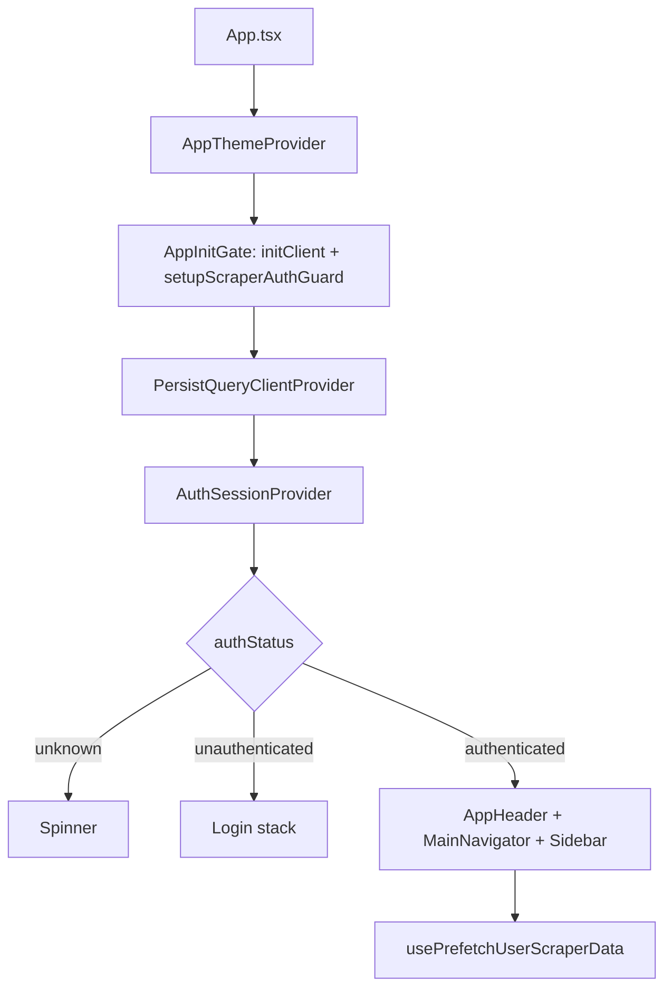

# WDMobile — przewodnik dla agenta AI

Mobilna aplikacja (Expo / React Native) dla studentów **Wyższej Szkoły Nauk** — dane pobierane ze scrapera portalu **WD** (`https://wd.ans-ns.edu.pl`), nie z oficjalnego API.

Ten plik opisuje architekturę, konwencje i miejsca, w których szukać informacji przy debugowaniu i dodawaniu funkcji.

---

## Stack

| Warstwa | Technologia |
|---------|-------------|
| UI | React 19, React Native 0.81, Expo ~54 |
| Nawigacja | `@react-navigation/stack` (stack, bez tabów) |
| HTTP | Axios + własny store ciasteczek |
| HTML | `linkedom` (`parseHTML`) |
| Cache / sync | TanStack Query v5 + persystencja AsyncStorage |
| Sekrety | `react-native-keychain` (zapamiętaj mnie), cookies natywne |

Wejście: `index.ts` → `App.tsx`.

---

## Struktura katalogów

```
app/
  screen/              # Ekrany (thin) — podłączają feature components
  features/<name>/     # UI + hooks specyficzne dla domeny (grades, plan, dashboard…)
  components/          # Współdzielone (AppHeader, sidebar, profile views)
  context/             # AuthSession, AppTheme, StudentProfile, ScreenRefresh, Sidebar
  hooks/               # Ogólne (network, prefetch, profile photo)
  navigation/          # navigationRef, typy tras
  theme/               # ansTheme, useThemedStyles
  core/
    auth/              # performSignOut, rememberMe, sessionUser
    queryClient/       # queryKeys, persystencja, useUserPersistentQuery
    scraper/           # cała logika WD (patrz niżej)
    network/           # reconnect
    preferences/       # dark mode storage
assets/                # ikony, logo
info.txt               # komendy dev (adb, expo)
app/version.ts         # APP_VERSION — sync z package.json i app.json
```

**Zasada warstw:** `screen` → `features/*/components` + `features/*/hooks` → `core/scraper` + `core/queryClient`. Nie importuj scrapera bezpośrednio z głębokich komponentów UI — przez hook lub service singleton w hooku.

---

## Przepływ aplikacji (bootstrap)



1. **`AppInitGate`** — `initClient()` (cookies), `setupScraperAuthGuard()` (interceptory axios).
2. **`AuthSessionProvider`** — po `persistReady` rozstrzyga sesję (cookies, remember me, degraded cache).
3. **Authenticated shell** — `StudentProfileProvider`, `SidebarProvider`, `ScreenRefreshProvider`.

---

## Scraper (najważniejsza warstwa)

### Klient HTTP

- `app/core/scraper/client/client.ts` — axios, `baseURL: WD_BASE_URL`
- `app/core/scraper/client/cookieStore.ts` — jar ciasteczek (CookieManager + migracja z AsyncStorage)
- Każdy request (oprócz `/Logowanie`) przechodzi przez **`ensureAuthenticatedBeforeScrape`** (interceptor w `ensureAuthenticated.ts`)

### Autentykacja

| Plik | Rola |
|------|------|
| `auth/auth.service.ts` | Logowanie, captcha, POST do WD |
| `auth/contextSelection.ts` | Po logowaniu: `/WyborKontekstu` → auto GET `/WybierzKontekst?…&personType=1` (Student) |
| `auth/userConsent.ts` | Ciasteczko `.user-consent` (wymagane przy wyborze kontekstu) |
| `auth/ensureAuthenticated.ts` | Guard requestów, silent login, retry po wygaśnięciu sesji |
| `auth/sessionValidation.ts` | `assertAuthenticatedHtml`, probe sesji, `SessionExpiredError` |
| `auth/session.store.ts` / `sessionLifetime.ts` | Flagi sesji, TTL |
| `core/auth/rememberMe.storage.ts`, `SecureStorageService.ts` | Zapamiętaj mnie (Keychain / Keystore) |
| `core/auth/performSignOut.ts` | Logout + czyszczenie cache i zdjęcia profilu |

**Remember me:** przy wygaśnięciu sesji próba silent login; offline / brak sieci → **tryb offline** (panel główny + `sessionDegraded`, bez wymogu cache). Polityka: `authSessionPolicy.ts`.

**Bez remember me:** ciasteczka WD przy **cold start** są czyszczone (`ephemeralSession.ts`); użytkownik trafia na ekran logowania — **bez** trybu offline z cache po restarcie aplikacji.

**Degraded mode:** tylko przy włączonym remember me — brak żywej sesji WD, wyświetlane dane z cache (`sessionDegraded`, `AuthSyncBanner`).

### Wzorzec feature scrapera

Każda domena w `app/core/scraper/features/<feature>/`:

```
*.fetch.ts    # GET/POST przez client (surowy HTML lub DX)
*.parse.ts    # linkedom → typowane obiekty; assertAuthenticatedHtml(html)
*.types.ts    # Typy domenowe
*.service.ts  # Klasa publiczna (getX → parse/fetch)
```

Opcjonalnie: `*.grid.ts`, `*.page.ts`, `merge*.ts` (np. oceny).

**DX (DevExpress callback):** odpowiedzi AJAX portalu — `app/core/scraper/parsers/dx.parser.ts` (`parseDxResponse` → `html`).

**Nowy endpoint WD:** zacznij od `fetch` (URL z istniejącego feature lub DevTools), potem `parse` + typy, na końcu `Service` i hook.

### Istniejące feature scrapera

| Folder | Opis |
|--------|------|
| `plan/` | Plan zajęć studenta (lekcje, tydzień) |
| `grades/` | Indeks ocen, semestry, partial (pojedynczy przedmiot) |
| `announcements/` | Lista + szczegóły ogłoszeń |
| `profile/` | Profil studenta, avatar/zdjęcie (`profile.avatar.ts`, `profilePhotoSessionCache.ts`) |
| `lecturers/` | Wyszukiwanie wykładowców + plan wykładowcy (**bez React Query cache**) |

---

## React Query i cache

### Klucze

`app/core/queryClient/queryKeys.ts` — wszystkie klucze **muszą** zawierać `userKey` (z `useQueryUserKey`: username z remember me lub `getLastUsername()`).

### Hooki danych

- **`useUserPersistentQuery`** — główny wzorzec: stale cache, sync na focus/reconnect, `syncStatus` (`idle` | `syncing` | …).
- **`useQuery`** (cache sesji, `gcTime` ~1h) — `usePartialGradesQuery`, `useAnnouncementDetailsQuery` (nie trafiają na dysk).
- **`createPersistentQueryHook`** — starszy wariant fabryki hooków (sprawdź, czy feature już go używa).

### Co jest persystowane na dysk (offline bundle)

`shouldPersistQuery.ts` — **whitelist** (nie cały root): `weekLessons` — poprzedni + bieżący + następny miesiąc kalendarzowy (`planWeekWindow.ts`), `grades.index`, `announcements.list`, `profile.summary` (bez base64) + `profile.details`. **Bez:** `partial`, `detail`, `semester`, `lessons`, tygodnie planu poza tym oknem.

- `maxAge`: `PERSIST_MAX_AGE_MS` (~90 dni) — stary blob AsyncStorage wygasa przy restore.
- `buster`: `PERSIST_QUERY_BUSTER` (`v2-offline-bundle`) — migracja starego przepełnionego cache.
- Przy zapisie: tygodnie planu poza 3-miesięcznym oknem są obcinane (`persistClientTransform.ts`).
- Awatar: `profilePhotoSessionCache` (RAM) + `profilePhotoPersist.storage.ts` (AsyncStorage); nie w blobie React Query (`profileSummaryPhoto.ts`, `persistClientTransform.ts`).

Profil: prefetch summary po logowaniu; ekran Profil (`profile.details`) — przy cache brak auto-scrapu przy wejściu (tylko pull-to-refresh / `forceRefresh`).

### Prefetch po logowaniu

`prefetchUserScraperData.ts` — po logowaniu: `profile.summary`. Plan tygodniowy (3 miesiące): `prefetchStudentPlanWeeks.ts` + `usePrefetchPlanWeekWindow` na panelu harmonogramu dashboardu; tygodnie poza oknem — lazy przy nawigacji (`useStudentPlanWeekLessons`, bez zapisu na dysk).

Dashboard i ekrany sidebar (Ogłoszenia, Oceny): `useUserPersistentQuery` (`staleTime` 6h, `syncOnMount`), `SyncBanner`, pull-to-refresh przez `forceRefresh` (jak harmonogram).

### Czyszczenie

`clearUserAppCache.ts` — przy wylogowaniu; invaliduje query per user.

---

## UI i nawigacja

### Trasy (`RootParamList`)

`Login` | `Dashboard` | `Plan` | `Grades` | `Announcements` | `Profile` | `FindLecturer` | `LecturerPlan` (params) | `Settings`

Nawigacja imperatywna: `navigationRef.ts` (`navigateTo`, `navigateToLecturerPlan`, `replaceTo`).

Sidebar: `AppSidebar` + `SidebarContext` — trasy bez `LecturerPlan` i `Login`.

### Motyw

- `AppThemeContext` + `ansTheme.ts` (`lightAnsColors` / `darkAnsColors`)
- Style: `useThemedStyles(createXStyles)` — factory `(colors: AnsColors) => StyleSheet`
- Pliki `*.styles.ts` obok komponentów

### Odświeżanie ekranów

`ScreenRefreshContext` + `RefreshableScrollView` — pull-to-refresh powiązany z refetch hooków na danym ekranie.

---

## Konteksty (kiedy używać)

| Context | Zastosowanie |
|---------|----------------|
| `AuthSessionContext` | `authStatus`, signOut, remember me, degraded |
| `StudentProfileContext` | Zdenormalizowany profil w headerze/sidebarze (oparty o `useStudentProfileQuery`) |
| `AppThemeContext` | `colors`, `isDarkMode` |
| `SidebarContext` | Otwarcie/zamknięcie menu |
| `ScreenRefreshContext` | Globalny refresh trigger |

---

## Checklist: nowa funkcja użytkowa

1. **Czy dane są na WD?** Ustal URL i format (HTML vs DX). Skopiuj wzorzec z najbliższego `features/*` w scraperze.
2. **Service + typy** w `core/scraper/features/<nazwa>/`.
3. **Hook** w `app/features/<nazwa>/hooks/`:
   - cache użytkownika → `useUserPersistentQuery` + wpis w `queryKeys.ts`
   - jednorazowe → `useQuery` + `useQueryUserKey`
4. **Persystencja?** Jeśli tak — dodaj root key do `shouldPersistQuery` i `queryKeys` (świadoma decyzja).
5. **Ekran** w `app/screen/` + komponenty w `app/features/<nazwa>/`.
6. **Trasa** — `navigationRef.ts`, `App.tsx` (`AppStack.Screen`), sidebar (`useSidebarActions` / menu).
7. **Prefetch** — opcjonalnie rozszerz `prefetchUserScraperData.ts`.
8. **Wersja** — przy release: `app/version.ts`, `package.json`, `app.json` (komentarz w `version.ts`).

### Feature bez cache (wzór: wykładowcy)

`FindLecturerScreen` — lokalny `useState`, bezpośrednio `new LecturersService()` w `useMemo`, fetch przy akcji użytkownika. Plan wykładowcy: `LecturerPlanScreen` + `lecturer-plan.service.ts`.

---

## Mapa „gdzie szukać”

| Pytanie | Gdzie |
|---------|--------|
| Jak dodać ekran? | `App.tsx`, `navigationRef.ts`, `app/screen/` |
| Jak pobrać oceny/plan? | `features/grades/hooks/*`, `features/plan/hooks/*` |
| Błąd logowania / captcha | `features/login/`, `auth/login.parser.ts`, `login.errors.ts` |
| Zapis loginu / autofill | `SecureStorageService.ts`, `useLoginStoredCredentials`, `LoginScreen.tsx` |
| Wybór kontekstu po logowaniu (inne wydziały) | `auth/contextSelection.ts`, `auth/contextSelection.parser.ts` |
| Sesja wygasła | `ensureAuthenticated.ts`, `AuthSessionContext`, `AuthSyncBanner` |
| Zdjęcie profilu | `profilePhotoSessionCache.ts`, `profileSummaryPhoto.ts`, `useProfilePhoto.ts`, `profile.avatar.ts` |
| Dashboard kafelki | `features/dashboard/dashboard.features.ts`, panele `Dashboard*Panel` |
| Test równoległych requestów | `core/utils/mapWithConcurrency.ts` |
| Ciemny motyw | `preferences/darkMode.storage.ts`, `SettingsScreen` |

---

## Aktualizacje OTA (expo-updates)

- **EAS Update** — poprawki JS/UI bez nowej instalacji ze sklepu (`npm run update:production`).
- **runtimeVersion** — `app.json` → `policy: "appVersion"` (zgodność z polem `version`). Przy OTA **nie podbijaj** `version` w `app.json`; podbij tylko przy nowym buildzie natywnym do sklepu.
- **Kanały** — `production` / `preview` w `eas.json` (muszą pasować do profilu `eas build`).
- **W aplikacji** — `AppUpdatesProvider`, baner + „Sprawdź aktualizacje” w Ustawieniach; OTA **nie działa** w `__DEV__` / Expo Go.
- Po pierwszej instalacji `expo-updates` wymagany **nowy** build natywny (APK/AAB z EAS).

---

## Komendy dev (skrót)

Z `info.txt` / `package.json`:

```bash
npx expo start
adb reverse tcp:8081 tcp:8081   # fizyczne urządzenie
npx expo run:android
npm run prebuild:android          # ikony + expo prebuild --clean
```
---

## Pułapki i konwencje kodu

- **Język UI:** polskie stringi w produkcie; komentarze w kodzie często po polsku.
- **Axios `validateStatus`:** 4xx nie rzuca — parsuj HTML i używaj `assertAuthenticatedHtml` / `responseIndicatesSessionExpired`.
- **Ścieżki importów:** w `core` często `"../../auth/..."`; w `features` względem `../../../core/...`.
- **Singleton service w hooku:** `const svc = new XService()` na poziomie modułu lub `useMemo` — nie twórz nowego przy każdym renderze w pętli.
- **Nie commituj** `node_modules/`, artefaktów `.gradle`, `.cxx` — szum z buildów Android.
- **Wersja:** jedno źródło `app/version.ts`; buildNumber/versionCode = liczba z wersji semantycznej (np. 0.1.3 → 103).

---

## Ostatnie obszary w rozwoju (stan repo)

Śledź zmiany poza `queryKeys` (często untracked w git):

- Profil: `StudentProfileContext`, `useStudentProfileQuery`, `useProfilePhoto`; awatar — `profilePhotoSessionCache` + `profileSummaryPhoto.ts` (nie duplikować w RQ)
- `performSignOut` czyści `profilePhotoSessionCache`
- Komponenty: `AppHeaderAvatar`, `ProfileSummaryView`, `DashboardMiniProfile`, `SidebarProfileHeader`

**Zdjęcie profilu:** jedna kopia w RAM — `profilePhotoSessionCache` (czyszczone przy wylogowaniu). `profile.summary` w React Query i na dysku **bez** pola `photo` (puste `photo`); scraper zapisuje base64 tylko do cache sesji (`profileSummaryPhoto.ts`). Po restarcie awatar pobierany ponownie przy sync profilu.

---

## Szybkie wyszukiwanie (grep)

```
queryKeys.          # wszystkie klucze cache
useUserPersistentQuery
class .*Service
parseHTML
ensureAuthenticated
WD_BASE_URL
navigateTo(
```

---

*Ostatnia aktualizacja przewodnika: 2026-05-20. Przy większych zmianach architektury zaktualizuj ten plik w tym samym PR.*
